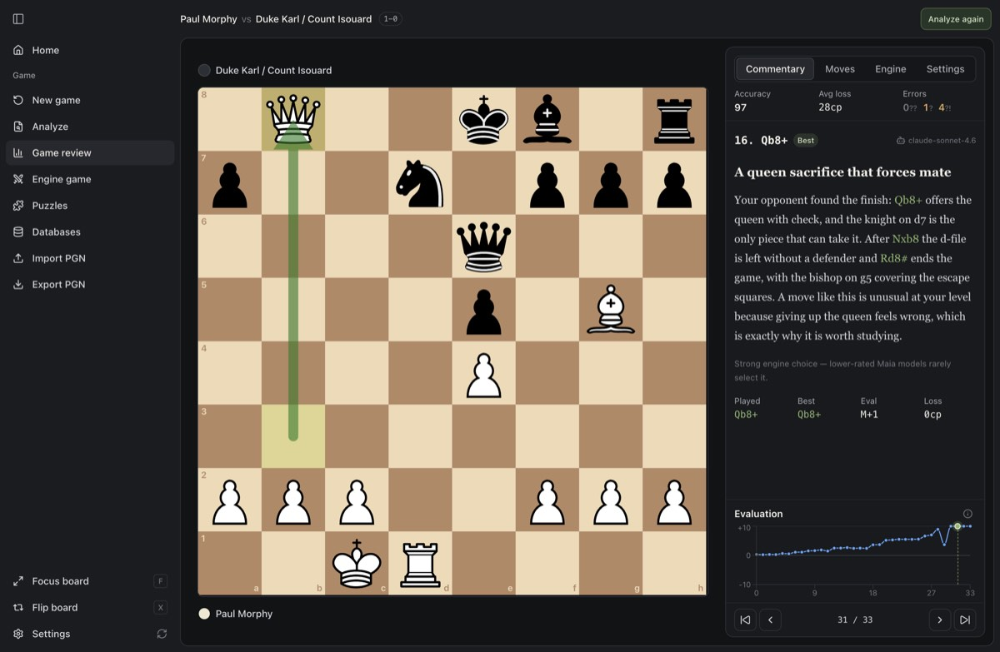

# Chaturanga

A desktop chess app for studying your own games. It reviews every move with Stockfish, shows how
players at your rating would likely have played (Maia 3), and explains the key moments in plain
language.



- **Game review:** accuracy, move grades, eval graph, and a coach that explains each move
- **Maia 3:** CSSLab's human-move model, one download of about 46 MB for every rating from 600 to 2600. In Game review it reads each side at its rating: the moves players at that rating would
  choose and how likely each is, how hard the best move was to find, and how often players at every
  rating would play a move
- **Analysis:** live engine lines and a move tree with variations
- **Play:** games against an engine, or Maia at a rating you choose, with clocks, plus puzzles from
  the Lichess database
- **Local-first:** games and engines stay on your machine; AI commentary runs through your own
  OpenRouter key
- **Usage data:** on by default, off with one switch in Settings; feature usage and AI commentary
  requests and answers, never your API keys or files ([what is collected](docs/telemetry.md))

## Download

Get the latest build from [Releases](https://github.com/ayush-porwal/chatrunga/releases)
(macOS, Windows, Linux).

The app checks for new versions itself (the button next to Settings), downloads them in the
background and installs them on restart. macOS builds aren't notarized yet, so the first time you
open a downloaded copy macOS asks you to confirm it (System Settings → Privacy & Security → Open
Anyway); updates after that install in place without asking. Keep the app in Applications so it can
replace itself.

## Development

Requires Node 24 and pnpm 11.

```bash
pnpm install
pnpm dev     # run the desktop app
pnpm test    # run tests
pnpm lint    # lint
```

Releases are built by the manual **release** workflow in GitHub Actions. In-app updates read the
public GitHub releases of the repo in `build.publish` (`apps/desktop/package.json`). To try the
update flow locally, run a packaged build with `CHATURANGA_UPDATE_FEED_URL` pointing at a folder
served over HTTP that holds a `latest-mac.yml` / `latest.yml` / `latest-linux.yml`.

Usage analytics (PostHog) is configured at build time with `MAIN_VITE_POSTHOG_PROJECT_TOKEN` and
`MAIN_VITE_POSTHOG_HOST`; development and test runs never send. See [docs/telemetry.md](docs/telemetry.md).

## License

Chaturanga is free software under the [GNU General Public License v3.0 or later](LICENSE). The
piece sets and the board's sound sets are their authors' work under their own licences, and the
engine logos are the marks of their projects. Maia 3 is CSSLab's: its model is downloaded at
runtime, and CSSLab's engine code (GPL-3.0, in
[apps/desktop/vendor/csslab-maia/](apps/desktop/vendor/csslab-maia/)) ships unmodified with the
libraries it runs on, ONNX Runtime Web (MIT) and chess.ts (BSD-2-Clause). All are credited in
[apps/desktop/resources/credits/](apps/desktop/resources/credits/) —
[PIECES.md](apps/desktop/resources/credits/PIECES.md),
[SOUNDS.md](apps/desktop/resources/credits/SOUNDS.md),
[ENGINES.md](apps/desktop/resources/credits/ENGINES.md) and
[MAIA.md](apps/desktop/resources/credits/MAIA.md), with the licence texts they need in
[licenses/](apps/desktop/resources/credits/licenses/). That folder and the `LICENSE` ship inside
every packaged build.
